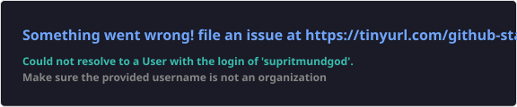

 

---

## 01 — Profile

I'm a Computer Science student interested in building intelligent applications and practical software products.

My focus is on combining AI capabilities with thoughtful full-stack engineering — from user-facing interfaces to backend systems and APIs.

**Currently exploring:** AI-powered applications · Full-stack systems · Backend engineering · Product development

---

## 02 — Technology

| Area | Technologies |
|:--|:--|
| **Languages** | Java · Python · JavaScript · SQL |
| **Frontend** | React · Next.js · HTML · CSS |
| **Backend** | Spring Boot · FastAPI · Flask |
| **Tools** | Git · GitHub · VS Code · IntelliJ IDEA |

---

## 03 — Selected work

<table>
<tr>
<td width="50%" valign="top">

**AI application development**

An AI-focused application project.

[Explore repository →](https://github.com/supritmundagod/NIMBUS-AI)
</td>
<td width="50%" valign="top">

**Retrieval-Augmented Generation**

A project exploring RAG-based applications.

[Explore repository →](https://github.com/supritmundagod/RAG)
</td>
</tr>
<tr>
<td colspan="2" valign="top">

**Web application development**

A web development project.

[Explore repository →](https://github.com/supritmundagod/KARTZO)
</td>
</tr>
</table>

[ **Browse all repositories →** ](https://github.com/supritmundagod?tab=repositories)

---

## 04 — GitHub activity

---

## 05 — Connect

If you're interested in AI, software engineering or building useful products, connect with me.

- **GitHub:** [@supritmundagod](https://github.com/supritmundagod)
- **LinkedIn:** [Suprit Mundgod](https://www.linkedin.com/in/suprit-mundagod)

*Build with intent. Learn continuously. Make useful things.*

